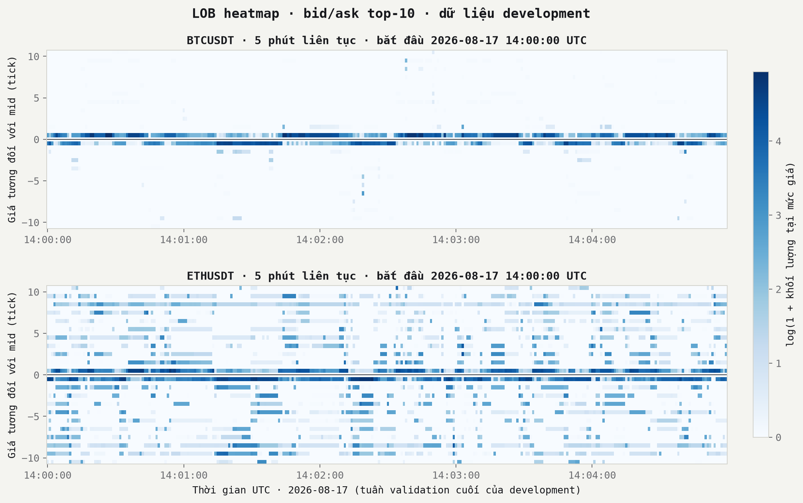
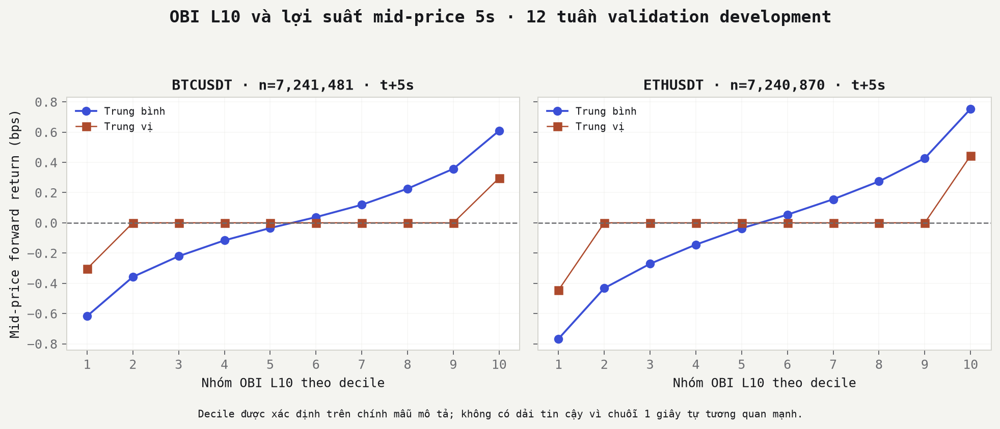
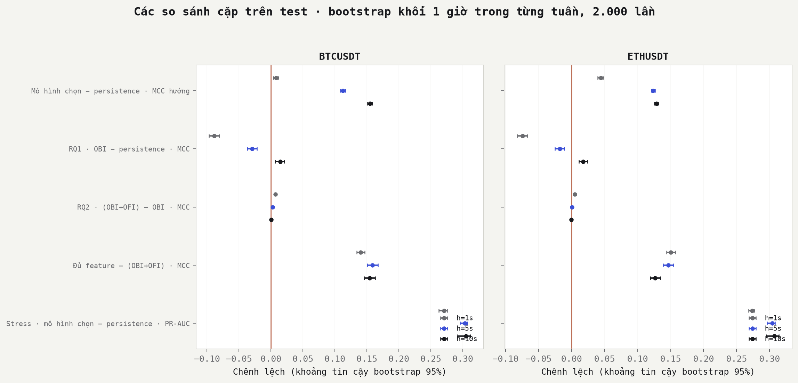
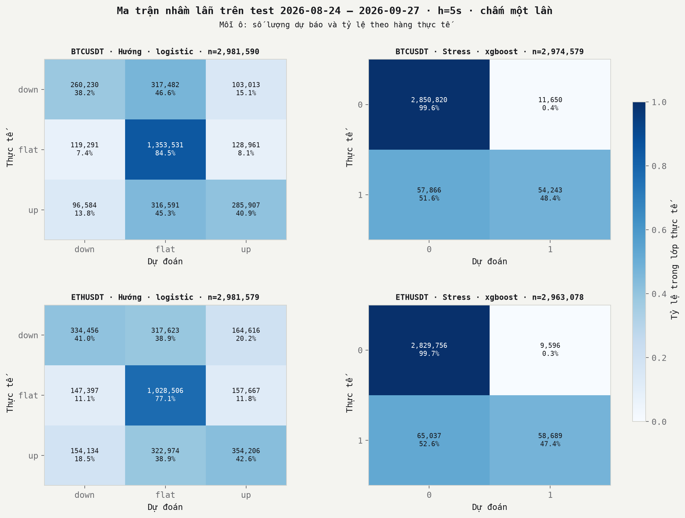
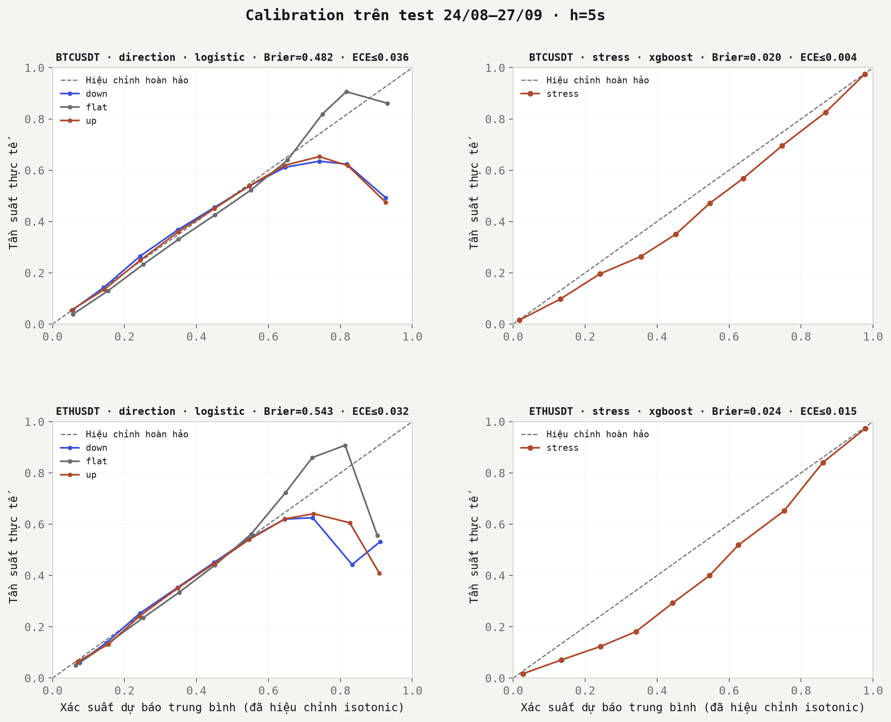
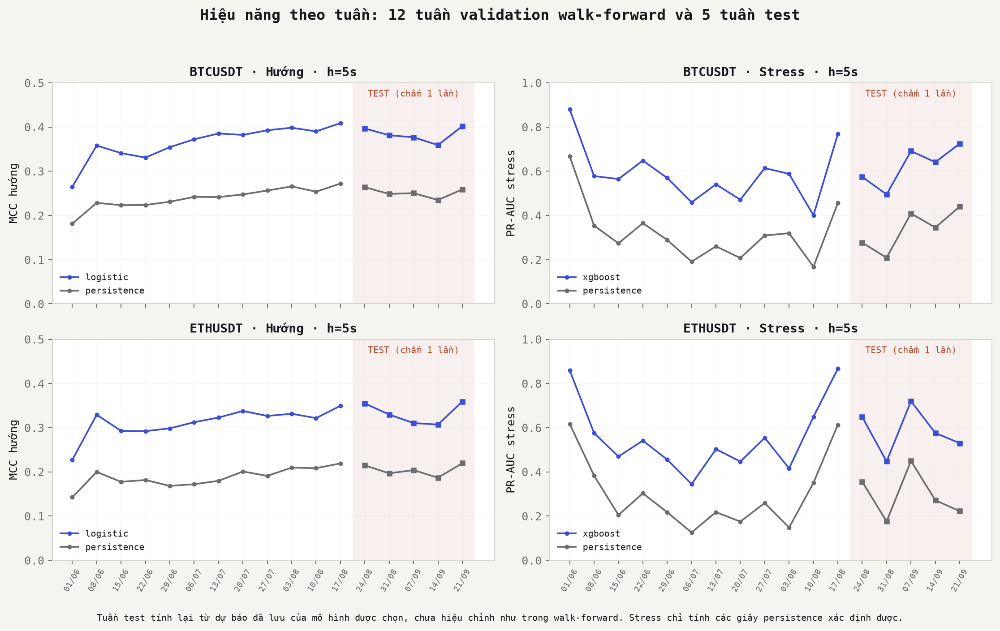
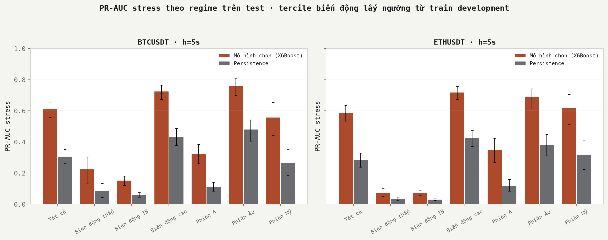

# Dự báo hướng giá ngắn hạn và stress thanh khoản từ Limit Order Book trên thị trường crypto

**Limit Order Book and Liquidity Stress Prediction in Cryptocurrency Markets: From Order Flow Imbalance to DeepLOB**

*Báo cáo nghiên cứu theo Research Blueprint 05. Đây là nghiên cứu học thuật, không phải khuyến nghị đầu tư.*

---

## Tóm tắt

Nghiên cứu kiểm tra xem trạng thái sổ lệnh (Limit Order Book, LOB) và dòng lệnh tại một thời điểm có chứa thông tin về (i) hướng mid-price sau 1, 5 và 10 giây và (ii) xác suất xảy ra stress thanh khoản hay không. Dữ liệu là sổ lệnh L2 (20 mức mỗi bên) của BTCUSDT và ETHUSDT trên Binance Spot từ 19/04 đến 27/09/2026, được replay thành lưới một giây. Mô hình được chọn bằng walk-forward theo tuần trên 12 tuần validation. Sau đó chúng được chấm đúng một lần trên năm tuần test chưa từng dùng (24/08–27/09/2026), theo quy trình đã chốt trước khi mở test.

Kết quả chính:

1. **OBI (độ lệch độ sâu sổ lệnh)** có quan hệ đơn điệu với lợi suất 5 giây (Spearman +0,37 với BTC, +0,31 với ETH). Tuy vậy, khi dùng một mình để dự báo hướng, OBI chỉ thắng baseline persistence ở horizon 10 giây; ở 1 và 5 giây, persistence tốt hơn.
2. **OFI (Order Flow Imbalance) theo sự kiện** bổ sung thông tin có ý nghĩa thống kê nhưng nhỏ về độ lớn. MCC tăng khoảng +0,005 đến +0,007 ở 1 giây và gần bằng 0 ở 10 giây. Hồi quy kinh tế lượng cho kết quả tương tự.
3. **Kết hợp đầy đủ feature** (spread, độ sâu, dòng lệnh, biến động) mới tạo khác biệt lớn: MCC tăng +0,13 đến +0,16 so với OBI+OFI. Mô hình được chọn thắng persistence trên test ở mọi horizon với stress (PR-AUC +0,27 đến +0,31), và với hướng giá ở 5 và 10 giây.
4. **DeepLOB** (CNN-LSTM) thua Logistic và XGBoost ở cả 12/12 tuần development, nên theo quy trình không được chấm trên test.
5. Khả năng dự báo stress **phụ thuộc mạnh vào regime**. PR-AUC đạt khoảng 0,72 khi biến động cao, nhưng chỉ 0,07–0,22 khi biến động thấp. Accuracy gần như vô nghĩa ở bài toán này: ở horizon 1 giây, việc luôn đoán "flat" đã đạt 82% accuracy nhưng MCC bằng 0.

Về ý nghĩa kinh tế: tín hiệu hướng giá trong sổ lệnh là có thật nhưng nhỏ hơn 1 bps, thấp hơn nhiều so với phí giao dịch taker. Giá trị thực tế của mô hình nằm ở việc **đo rủi ro thanh khoản**: xác suất stress đã hiệu chỉnh khớp với tần suất thực tế, nên có thể dùng làm chỉ báo cho quyết định thực thi lệnh và quản trị thanh khoản. Không nên dùng nó làm tín hiệu giao dịch.

---

## Thuật ngữ dùng trong báo cáo

Bảng dưới giải thích ngắn các khái niệm chính cho người đọc chưa quen với vi cấu trúc thị trường. Định nghĩa chính xác bằng công thức nằm ở mục 2 và 4.

| Thuật ngữ | Giải thích ngắn |
|---|---|
| Sổ lệnh (order book, LOB) | Danh sách mọi lệnh mua và bán đang chờ khớp. Bên mua (bid) ghi giá họ sẵn sàng trả, bên bán (ask) ghi giá họ muốn nhận. |
| Mid-price | Điểm giữa giá mua cao nhất và giá bán thấp nhất. Đây là giá được dự báo tăng, giảm hay đứng yên. |
| Spread | Khoảng cách giữa giá bán thấp nhất và giá mua cao nhất. Spread càng nhỏ, giao dịch càng rẻ. |
| Tick, bps | Tick là bước giá nhỏ nhất (0,01 USDT). bps (basis point) là 0,01%. |
| OBI | Độ lệch khối lượng chờ mua so với chờ bán, từ −1 (toàn bán) đến +1 (toàn mua): xem hàng chờ mua hay hàng chờ bán dài hơn. |
| OFI | Dòng lệnh đổ vào trong vài giây gần nhất. OBI là ảnh chụp sổ lệnh, OFI là đoạn phim ngắn về việc sổ lệnh vừa thay đổi thế nào. |
| Stress thanh khoản | Lúc thị trường khó giao dịch: spread giãn, sổ lệnh mỏng, giá giật mạnh, hoặc một lệnh 2.000 USDT làm giá trượt nhiều. |
| Persistence | Cách dự báo đơn giản nhất dùng để so sánh: giả định mọi thứ giữ nguyên như vài giây trước. |
| Horizon | Khoảng thời gian dự báo về phía trước: 1, 5 hoặc 10 giây. |
| MCC | Điểm chất lượng dự báo từ −1 đến 1; 0 nghĩa là không hơn đoán mò. Không bị đánh lừa khi một lớp chiếm đa số. |
| PR-AUC | Điểm từ 0 đến 1 đo khả năng xếp những lúc sắp stress lên đầu danh sách cảnh báo. Càng cao càng tốt. |
| Calibration | Mức khớp giữa xác suất mô hình đưa ra và tần suất thực tế: nói 30% thì xảy ra khoảng 30% số lần. |
| Development, test | Development (19/04–23/08) dùng để xây và chọn mô hình. Test (24/08–27/09) được giấu đi và chỉ chấm một lần, như một bài thi chưa từng thấy đề. |

## 1. Giới thiệu

Phần lớn nghiên cứu dự báo giá crypto dùng dữ liệu theo ngày hoặc theo giờ. Ở thang thời gian đó, giá gần như là bước ngẫu nhiên và tín hiệu rất yếu. Ở thang vài giây, giá được hình thành trực tiếp từ sự tương tác giữa lệnh giới hạn chờ trong sổ lệnh và lệnh thị trường khớp vào đó. Đây là đối tượng của vi cấu trúc thị trường (market microstructure). Bài toán ở thang này có cấu trúc rõ ràng hơn, nhưng đòi hỏi xử lý hàng chục triệu quan sát và kiểm soát chặt rò rỉ thông tin theo thời gian.

Nghiên cứu có năm câu hỏi:

- **RQ1.** Độ lệch độ sâu sổ lệnh (OBI) có dự báo được chuyển động của mid-price không?
- **RQ2.** Order Flow Imbalance (OFI) có chứa nhiều thông tin hơn OBI tĩnh không?
- **RQ3.** DeepLOB cải thiện được bao nhiêu so với Logistic và XGBoost?
- **RQ4.** Mô hình có ổn định khi regime biến động thay đổi không?
- **RQ5.** Accuracy còn có ý nghĩa không, khi đưa độ bất định và mất cân bằng lớp vào đánh giá?

Đóng góp của nghiên cứu:

- một pipeline replay sổ lệnh có kiểm tra số thứ tự cập nhật;
- một thiết kế đánh giá walk-forward với test chỉ mở một lần;
- một định nghĩa stress thanh khoản đa chiều, vì nhãn chỉ dựa trên spread bị suy biến;
- một sản phẩm minh họa, Liquidity Stress Meter, hiển thị xác suất đã hiệu chỉnh theo thời gian thực.

## 2. Vi cấu trúc thị trường và biểu diễn sổ lệnh

### 2.1. Sổ lệnh, mid-price và spread

Tại thời điểm $t$, sổ lệnh gồm các mức giá mua (bid) $b^l_t$ và bán (ask) $a^l_t$, với khối lượng chờ $Q^{bid}_{l,t}$ và $Q^{ask}_{l,t}$, trong đó $l = 1, \dots, L$ là thứ tự mức giá tính từ giá tốt nhất. Ta có:

$$m_t = \frac{a^1_t + b^1_t}{2}, \qquad Spread_t = a^1_t - b^1_t, \qquad Microprice_t = \frac{a^1_t Q^{bid}_{1,t} + b^1_t Q^{ask}_{1,t}}{Q^{bid}_{1,t} + Q^{ask}_{1,t}}.$$

Microprice dịch về phía bên có ít khối lượng hơn, nên phản ánh áp lực mua hoặc bán ngay tại mức giá tốt nhất.

Cả BTCUSDT và ETHUSDT đều có tick 0,01 USDT, và spread gần như luôn bằng đúng một tick (trung vị 1 tick ở cả hai cặp, Bảng 2). Với BTC giá khoảng 63.000 USDT, một tick chỉ là 0,0015 bps. Hệ quả là nhãn stress chỉ dựa trên spread gần như không bao giờ dương (mục 4.2).

### 2.2. Order-book imbalance (OBI)

$$OBI^L_t = \frac{\sum_{l=1}^{L} Q^{bid}_{l,t} - \sum_{l=1}^{L} Q^{ask}_{l,t}}{\sum_{l=1}^{L} Q^{bid}_{l,t} + \sum_{l=1}^{L} Q^{ask}_{l,t}}, \qquad L \in \{1, 5, 10, 20\}.$$

OBI dương nghĩa là phía mua dày hơn. Trực giác kinh tế: lệnh thị trường sẽ "ăn" hết phía mỏng hơn trước, nên mid-price có xu hướng dịch về phía đó.

### 2.3. Order Flow Imbalance (OFI)

OBI là ảnh chụp tĩnh. OFI (Cont, Kukanov và Stoikov, 2014) đo **dòng** thay đổi ở mức giá tốt nhất qua từng sự kiện $n$:

$$e_n = \mathbb{1}(P^b_n \ge P^b_{n-1})\, q^b_n - \mathbb{1}(P^b_n \le P^b_{n-1})\, q^b_{n-1} - \mathbb{1}(P^a_n \le P^a_{n-1})\, q^a_n + \mathbb{1}(P^a_n \ge P^a_{n-1})\, q^a_{n-1},$$

rồi cộng dồn qua các cửa sổ 1, 5 và 10 giây gần nhất. OFI phải được tính trong lúc replay từng sự kiện, vì không thể dựng lại nó từ ảnh chụp mỗi giây. Đây là lý do cần dữ liệu sự kiện độ sâu có số thứ tự cập nhật, chứ không chỉ snapshot.

### 2.4. Hình ảnh sổ lệnh

*Hình 1. Heatmap sổ lệnh top 10, trong 5 phút liên tục từ 14:00 UTC ngày 17/08/2026 (development).*

> **Cách đọc hình.** Trục ngang là thời gian; trục dọc là khoảng cách tới giá giữa, tính bằng tick (phía trên là lệnh bán, phía dưới là lệnh mua). Màu càng đậm, càng nhiều khối lượng đang chờ ở mức giá đó.
>
> **Nói đơn giản.** Lệnh BTC dồn gần hết ở mức giá sát nhất, phía sau rất mỏng; ETH trải đều hơn. Khoảng cách mua–bán của BTC siêu hẹp, nhưng một lệnh lớn sẽ nhanh chóng "ăn" hết lớp đầu và làm giá trượt. Vì vậy, đo thanh khoản không thể chỉ nhìn spread.

Trong khung này, spread của cả hai cặp là 1 tick. Thanh khoản BTC tập trung gần như hoàn toàn ở mức giá tốt nhất: độ sâu L10 trung vị là 3,37 BTC phía bid và 5,10 BTC phía ask. Ngược lại, ETH trải đều qua 10 mức (52,1 và 46,1 ETH). Vì vậy một lệnh lớn trên BTC nhanh chóng vượt khỏi mức 1, và price impact là thành phần không thể thiếu khi đo thanh khoản.

## 3. Dữ liệu

### 3.1. Nguồn và replay

Dữ liệu thô là archive CryptoHFTData của Binance Spot. Nó gồm snapshot sổ lệnh, các cập nhật độ sâu có update ID, và giao dịch có cờ buyer-maker, nhờ đó xác định được phía chủ động của từng giao dịch. Binance REST chỉ cho snapshot hiện tại và không cho lấy lại lịch sử L2, nên archive là nguồn bắt buộc cho đánh giá trên dữ liệu quá khứ.

Mỗi cặp được replay độc lập:

- Snapshot khởi tạo sổ lệnh.
- Một cập nhật chỉ được áp dụng khi dải update ID của nó nối tiếp đúng chuỗi hiện tại.
- Khi chuỗi bị đứt, sổ lệnh bị đánh dấu không hợp lệ cho tới khi có snapshot mới.
- Lưới một giây chỉ xuất ra một dòng khi sổ lệnh hợp lệ và không quá cũ (≤ 2 giây).
- Không nội suy qua khoảng thiếu, và không trộn ngẫu nhiên dữ liệu.

Trước ngày 24/08/2026, archive phần lớn không có snapshot đi kèm. Với những ngày đó, sổ lệnh được dựng **xấp xỉ** (warm-start) từ chuỗi cập nhật. Khi kiểm tra trên các ngày có cả hai nguồn, nhãn stress từ sổ lệnh xấp xỉ khớp ≥ 99,99% với nhãn từ sổ lệnh chính xác, sau 5 phút khởi động. Với mỗi ngày, lưới cuối cùng chọn nguồn có nhiều giây hợp lệ hơn. **Toàn bộ test dùng sổ lệnh chính xác.**

### 3.2. Phân chia thời gian và độ phủ

| Giai đoạn | Thời gian (UTC) | Vai trò | Giây hợp lệ (BTC / ETH) |
|---|---|---|---|
| Development | 19/04 – 23/08/2026 | Train và 12 tuần validation walk-forward (từ 01/06) | 10,94 triệu / 10,94 triệu |
| Test chưa dùng | 24/08 – 27/09/2026 | Chấm một lần; chỉ dùng sổ lệnh chính xác | 2,98 triệu / 2,98 triệu |
| Đã dùng bởi pilot | 28/09 – 18/10/2026 | Không bao giờ được đọc trong nghiên cứu này | — |

Độ phủ khoảng 99,7% số giây kỳ vọng ở development và 98,6% ở test. Dữ liệu được lưu dạng Parquet, phân vùng theo cặp và ngày, kèm manifest SHA-256 và báo cáo chất lượng theo ngày (`outputs/data_quality/`, `outputs/manifests/unified_6m/`).

### 3.3. Feature

Có 27 feature, chỉ dùng thông tin tại hoặc trước thời điểm $t$:

- spread tính theo tick và theo bps, và độ lệch microprice so với mid;
- OBI ở L = 1, 5, 10, 20;
- độ sâu theo khối lượng ở 5, 10, 20 mức, và độ sâu theo giá trị (notional) ở 10 mức;
- OFI trong 1, 5, 10 giây;
- mất cân bằng giao dịch chủ động trong 5 và 10 giây;
- price impact khi quét 2.000 USDT;
- cường độ thêm và rút khối lượng hiển thị trong 1 và 5 giây;
- biến động thực hiện (realized variance) trong 10, 60, 300 giây.

Từ dữ liệu độ sâu công khai không phân biệt được một lần rút khối lượng là hủy lệnh hay khớp lệnh. Vì vậy "cancellation intensity" chỉ là một đại lượng đại diện cho việc khối lượng hiển thị giảm đi. Các cửa sổ cuộn bắt đầu lại sau mỗi lần chuỗi bị đứt.

Notional dùng để tính impact được chọn bằng một quy tắc chỉ dựa trên dữ liệu train: lấy mức lớn nhất trên một lưới cố định mà cả hai phía sổ lệnh lấp đầy được trong ≥ 99% số giây. Kết quả là 2.000 USDT cho cả hai cặp. Notional của pilot (250.000 và 100.000 USDT) quá lớn so với 20 mức giá, khiến 77–98% số giây không tính được impact.

**Bảng 2** (tóm tắt, development, giây hợp lệ). Bản đầy đủ: `outputs/tables/report_6m/table2_feature_summary_development.csv`.

| Feature | BTC: p1 | BTC: trung vị | BTC: p99 | ETH: p1 | ETH: trung vị | ETH: p99 |
|---|---|---|---|---|---|---|
| spread (tick) | 1 | 1 | 1 | 1 | 1 | 1 |
| relative spread (bps) | 0,0012 | 0,0015 | 0,0017 | 0,041 | 0,053 | 0,064 |
| price impact 2.000 USDT (bps) | 0,0006 | 0,0008 | 0,26 | 0,0206 | 0,027 | 0,71 |
| OBI L10 | −0,993 | −0,006 | 0,993 | −0,991 | 0,015 | 0,991 |
| OFI 1 giây (đơn vị coin) | −19,2 | 0 | 18,7 | −247 | 0 | 242 |
| độ sâu notional top 10 (USDT) | 126.200 | 438.300 | 1.411.000 | 43.240 | 170.400 | 502.800 |
| rv_300s | 1,1·10⁻⁹ | 3,4·10⁻⁷ | 9,3·10⁻⁶ | 1,4·10⁻⁸ | 6,9·10⁻⁷ | 1,9·10⁻⁵ |

Tỷ lệ thiếu cao nhất của một feature là 0,6% với BTC (rv_300s) và 1,6% với ETH (mất cân bằng giao dịch 5 giây, do có những khoảng 5 giây không có giao dịch nào). OBI L10 trải rộng trên cả đoạn [−1, 1], với độ lệch chuẩn 0,66 (BTC) và 0,64 (ETH), lớn hơn độ lệch chuẩn của phân bố đều (0,58). Như vậy sổ lệnh thường nghiêng hẳn về một phía ở các mức giá đầu, chứ hiếm khi cân bằng.

## 4. Định nghĩa nhãn

### 4.1. Hướng mid-price

$$y_{t,h} = \begin{cases} \text{up}, & m_{t+h} - m_t > \delta_h \\ \text{flat}, & |m_{t+h} - m_t| \le \delta_h \\ \text{down}, & m_{t+h} - m_t < -\delta_h \end{cases} \qquad h \in \{1, 5, 10\}\ \text{giây}.$$

Horizon tính theo giây, với 5 giây là horizon chính. $\delta_h$ là trung vị của $|m_{t+h} - m_t|$ trên đoạn train đầu tiên, được cố định trước khi so sánh mô hình. Với BTC, $\delta = 0$ ở 1 và 5 giây, nghĩa là "flat" chính xác là mid không đổi, và $\delta = 2{,}54$ USDT ở 10 giây. Với ETH, $\delta = 0$, 0,02 và 0,15 USDT. Nhãn không được tạo nếu bất kỳ giây nào trong $[t, t+h]$ bị thiếu hoặc sổ lệnh không hợp lệ.

### 4.2. Stress thanh khoản

Đề gợi ý dùng $Stress_{t+h} = \mathbb{1}(Spread_{t+h} > Q_{0.95})$. Trên dữ liệu này, spread gần như luôn bằng 1 tick, nên nhãn đó chỉ có khoảng 0,04–0,07% giá trị dương và mô hình không học được gì (Bảng 1). Vì vậy nhãn chính là **nhãn đa chiều (composite)**. Stress tại $t+h$ bằng 1 khi xảy ra **bất kỳ** điều kiện nào sau đây:

- spread vượt $Q_{0.975}$ của train;
- price impact 2.000 USDT vượt $Q_{0.975}$ của train;
- biến động 60 giây vượt $Q_{0.975}$ của train;
- độ sâu notional top 10 thấp hơn $Q_{0.025}$ của train.

Các ngưỡng được fit lại trong từng fold, chỉ trên dữ liệu train của fold đó. Nhãn chỉ dựa trên spread được giữ lại làm phép thử độ nhạy, không bao giờ thay cho nhãn chính sau khi đã xem kết quả.

**Bảng 1.** Phân bố lớp (h = 5 giây; bản đầy đủ cho mọi horizon nằm trong `table1_class_distribution.csv`).

| Cặp | Lớp | Train development | Test |
|---|---|---|---|
| BTC | down / flat / up | 23,7% / 52,6% / 23,7% | 22,8% / 53,7% / 23,5% |
| BTC | stress (composite) | 6,83% | 3,77% |
| BTC | stress (chỉ spread, Q95) | 0,066% | 0,057% |
| ETH | down / flat / up | 26,8% / 45,7% / 27,5% | 27,4% / 44,7% / 27,9% |
| ETH | stress (composite) | 6,74% | 4,18% |
| ETH | stress (chỉ spread, Q95) | 0,043% | 0,052% |

Ở horizon 1 giây, lớp "flat" chiếm 82% (BTC) và 76% (ETH). Tỷ lệ stress trên test nằm trong khoảng 2–10% đã đăng ký trước. Tuy vậy, theo từng tháng trong development, tỷ lệ này dao động mạnh: BTC 3,2–15,9%, ETH 1,8–16,6%, cao nhất vào tháng 6 (`table1b`). Stress tập trung thành từng đợt.

## 5. Kiểm soát rò rỉ thông tin (leakage)

1. **Feature tại thời điểm $t$** chỉ dùng các sự kiện xảy ra tại hoặc trước $t$. OFI được tính theo thứ tự sự kiện, không theo thời điểm nhận dữ liệu.
2. **Walk-forward mở rộng theo tuần.** Có 12 fold. Mỗi fold train trên mọi dữ liệu trước tuần validation và không bao giờ dùng dữ liệu tương lai.
3. **Purge và embargo 300 giây.** Mọi điểm train có cửa sổ nhãn chồng lên tuần validation đều bị loại. Khoảng cách 300 giây bằng mức lớn nhất trong ba con số: horizon (10 giây), cửa sổ feature dài nhất (300 giây) và độ dài chuỗi của DeepLOB (100 giây).
4. **Mọi thứ được học từ dữ liệu chỉ fit trên train hoặc validation của fold**: δ, các ngưỡng stress, imputer, scaler, calibration và ngưỡng quyết định.
5. **Test được mở đúng một lần.** Quy trình chấm test được ghi vào `docs/methodology.md` ngày 28/10/2026, trước khi mở test. Trước khi đọc phân vùng test đầu tiên, script ghi một file đánh dấu (`final_test_opened.json`). Sau đó, mọi lần chạy lại đều bị từ chối, trừ khi có cờ `--allow-repeat-final-test`, và cờ này chưa từng được dùng. Các phân tích sau đó (regime, bootstrap, hình) chỉ đọc dự báo đã lưu.
6. **Diễn tập.** Toàn bộ quy trình chấm cuối được chạy thử trên dữ liệu development, với một "test giả" từ 10 đến 23/08, trước khi chạy thật.
7. **Một thay đổi thiết kế sau khi chốt quy trình**: notional dùng để tính impact. Thay đổi này dùng quy tắc chỉ dựa trên dữ liệu train và được làm trước khi mở test. Trước và sau khi đổi đều được ghi trong `docs/change_log.md`.

## 6. Mô hình và đánh giá

**Baseline:**

- **Class frequency**: dự báo theo tỷ lệ lớp của train và luôn đoán lớp phổ biến nhất.
- **Persistence**, với hướng giá: đoán hướng của $h$ giây vừa qua.
- **Persistence**, với stress: lấy trạng thái stress hiện tại làm dự báo.

**Mô hình cổ điển:**

- Logistic Regression đa thức trên ba tập feature: chỉ OBI; OBI+OFI; đầy đủ 27 feature.
- Random Forest và XGBoost trên đủ 27 feature.

Mỗi lần fit dùng 250.000 dòng train, lấy mẫu phân tầng theo lớp.

**Mô hình học sâu:** DeepLOB (Zhang, Zohren và Roberts, 2019). Đầu vào là chuỗi 100 giây × 40 kênh, gồm giá và khối lượng của 10 mức mỗi bên. Mạng gồm các lớp tích chập (CNN) học cấu trúc giữa các mức giá, rồi LSTM học diễn biến theo thời gian; tổng cộng khoảng 39,5 nghìn tham số. Vì giới hạn tính toán, DeepLOB train trên 8.000 chuỗi mỗi fold và được so với Logistic và XGBoost trên cùng 2.500 điểm validation mỗi tuần.

**Chọn mô hình.** Dùng trung bình 12 tuần validation: với hướng giá là macro-F1, với stress là PR-AUC; MCC dùng để phân định khi hòa. Kết quả: random forest cho hướng ở 1 giây, Logistic cho hướng ở 5 và 10 giây, XGBoost cho stress ở mọi horizon. Mô hình cuối được fit trên development đến trước ngày test trừ embargo. Calibration isotonic và ngưỡng stress (chọn để MCC lớn nhất, ra 0,40–0,45) được fit trên dự báo out-of-sample của walk-forward.

**Chỉ số đánh giá:**

- macro-F1, balanced accuracy, MCC, precision và recall theo lớp;
- Brier score và calibration (ECE);
- PR-AUC cho stress.

Accuracy chỉ được báo cáo để tham khảo.

**Kiểm định:**

- McNemar trên tính đúng sai của từng dự báo.
- Diebold–Mariano trên Brier loss, lấy trung bình theo phút, với sai số Newey–West (bandwidth tự động, tối thiểu 10 phút).
- Bootstrap theo khối 1 giờ trong từng tuần: 2.000 lần lặp, có hiệu chỉnh Holm.
- Cho RQ1/RQ2 còn có một benchmark kinh tế lượng: hồi quy lợi suất tương lai theo OBI và OFI đã chuẩn hóa, theo tinh thần Chordia, Roll và Subrahmanyam (2002), với sai số Newey–West 60 + h độ trễ.

## 7. Kết quả

### 7.1. OBI, OFI và lợi suất tương lai (RQ1, RQ2)

*Hình 2. Lợi suất mid-price sau 5 giây theo decile OBI L10, trên 12 tuần validation (7,24 triệu giây mỗi cặp).*

> **Cách đọc hình.** Mọi giây được chia thành 10 nhóm, từ lúc phe bán áp đảo (nhóm 1) đến lúc phe mua áp đảo (nhóm 10). Trục dọc là giá thay đổi bao nhiêu sau 5 giây, tính bằng bps. Đường xanh là mức trung bình, đường đỏ là mức ở giữa (trung vị).
>
> **Nói đơn giản.** Phe nào đông hơn thì giá có xu hướng nhích về phía đó, và quan hệ này đều đặn từ nhóm 1 đến nhóm 10. Nhưng mức nhích chưa tới 0,01%, trong khi phí giao dịch thông thường là 0,1%. Có tín hiệu, nhưng không đủ để kiếm lời.

Lợi suất trung bình tăng đơn điệu từ −0,62 lên +0,61 bps (BTC) và từ −0,77 lên +0,75 bps (ETH), đi từ decile thấp nhất tới cao nhất. Spearman bằng +0,37 và +0,31. Trung vị bằng 0 ở 8/10 decile: phần lớn các khoảng 5 giây không có chuyển động nào, và tín hiệu đến từ một số ít giây có giá đổi.

**Benchmark kinh tế lượng** (development):

- **Trong mẫu**: OBI và OFI đều có ý nghĩa rất cao. Với BTC ở 1 giây, hệ số của OFI 1 giây có t = 194, của OBI L1 có t = 9,9. R² ngoài mẫu ở 12 fold:

| | 1 giây | 5 giây | 10 giây |
|---|---|---|---|
| BTC: chỉ OBI | 0,042 | 0,052 | 0,043 |
| BTC: OBI + OFI | 0,050 | 0,056 | 0,046 |
| ETH: chỉ OBI | 0,050 | 0,044 | 0,031 |
| ETH: OBI + OFI | 0,056 | 0,045 | 0,032 |

- Thêm OFI làm R² ngoài mẫu tăng ở mọi horizon, và kiểm định Diebold–Mariano xác nhận mức tăng này (t = 12 đến 39). Mức tăng giảm dần theo horizon, từ +0,009 xuống +0,002 với BTC. Thêm biến kiểm soát (spread, rv_60s) không thay đổi kết quả.

**Trên test (phân loại, bootstrap):**

*Hình 3. Chênh lệch của các cặp mô hình trên test, kèm khoảng tin cậy bootstrap 95%.*

> **Cách đọc hình.** Mỗi chấm là mức chênh lệch điểm giữa hai cách dự báo, thanh ngang là khoảng tin cậy 95%. Chấm nằm bên phải đường đỏ nghĩa là cách thứ nhất tốt hơn. Ba màu là ba horizon: 1, 5 và 10 giây.
>
> **Nói đơn giản.** Riêng OBI chỉ thắng cách đoán đơn giản ở 10 giây. Thêm OFI gần như không đổi gì. Kết hợp đủ thông tin thì tăng rõ rệt, và với stress, mô hình vượt cách đoán đơn giản ở mọi horizon.

- **RQ1, OBI so với persistence (MCC).** BTC: −0,089 / −0,029 / +0,015 ở 1 / 5 / 10 giây. ETH: −0,074 / −0,018 / +0,018. Mọi khoảng tin cậy đều không chứa 0, trừ macro-F1 của ETH ở 5 giây (p = 0,51). OBI luôn tốt hơn class frequency (MCC 0,14–0,23 so với 0). Ở horizon rất ngắn, hướng vừa qua là dự báo mạnh hơn, còn OBI có lợi thế ở 10 giây. Kết quả này lặp lại đúng như trên development, nơi OBI thắng 10/12 tuần ở 10 giây.
- **RQ2, thêm OFI vào OBI (MCC).** BTC: +0,007 / +0,003 / +0,0003. ETH: +0,005 / +0,001 / −0,0002. Mức tăng có ý nghĩa thống kê nhưng nhỏ, và biến mất ở 10 giây.
- **Bộ feature đầy đủ so với OBI+OFI.** MCC +0,13 đến +0,16 ở mọi horizon và cả hai cặp. Thông tin hữu ích nằm chủ yếu ở việc **kết hợp** spread, độ sâu, biến động và dòng giao dịch, không nằm ở riêng một chỉ số mất cân bằng nào.

> **Tóm lại mục 7.1 (RQ1, RQ2).** Nhìn sổ lệnh nghiêng về bên nào (OBI) giúp đoán hướng giá một chút, nhưng chỉ hơn cách đoán "giá đi tiếp như vừa rồi" khi dự báo xa 10 giây. Thông tin về dòng lệnh (OFI) thêm được rất ít và chỉ có ích trong 1–2 giây. Muốn dự báo tốt, phải kết hợp nhiều loại thông tin cùng lúc.

### 7.2. Kết quả chính trên test

**Bảng 3a.** Mô hình được chọn (đã hiệu chỉnh) so với persistence. Mọi kiểm định McNemar và Diebold–Mariano đều cho p < 10⁻⁸⁰; thống kê DM trên Brier dao động từ −39 đến −115.

| Cặp | h | Hướng macro-F1 (mô hình / persistence) | Hướng MCC | Stress PR-AUC (mô hình / persistence) | Stress MCC |
|---|---|---|---|---|---|
| BTC | 1 giây | 0,479 / 0,522 | 0,297 / 0,289 | 0,724 / 0,453 | 0,686 / 0,650 |
| BTC | 5 giây | 0,558 / 0,447 | 0,367 / 0,255 | 0,611 / 0,306 | 0,621 / 0,519 |
| BTC | 10 giây | 0,526 / 0,350 | 0,318 / 0,163 | 0,567 / 0,261 | 0,591 / 0,471 |
| ETH | 1 giây | 0,499 / 0,510 | 0,319 / 0,275 | 0,682 / 0,407 | 0,654 / 0,610 |
| ETH | 5 giây | 0,538 / 0,410 | 0,330 / 0,206 | 0,590 / 0,283 | 0,628 / 0,492 |
| ETH | 10 giây | 0,473 / 0,321 | 0,251 / 0,122 | 0,559 / 0,248 | 0,597 / 0,454 |

**Bảng 3b.** Mọi mô hình, BTC, h = 5 giây, trên test. Bảng đầy đủ: `table3_baseline_metrics_test.csv`.

| Mô hình | Hướng macro-F1 | Hướng MCC | Hướng Brier | Stress PR-AUC | Stress MCC (ngưỡng 0,5) |
|---|---|---|---|---|---|
| Class frequency | 0,233 | 0,000 | 0,604 | — | — |
| Persistence | 0,447 | 0,255 | 0,814 | 0,306 | 0,519 |
| Logistic, chỉ OBI | 0,415 | 0,225 | 0,625 | — | — |
| Logistic, OBI+OFI | 0,420 | 0,228 | 0,622 | — | — |
| Logistic, đủ feature | 0,585 | 0,387 | 0,517 | 0,532 | 0,329 |
| Random Forest | 0,581 | 0,381 | 0,486 | 0,528 | 0,522 |
| XGBoost | 0,578 | 0,392 | 0,463 | 0,613 | 0,629 |
| **Mô hình chọn, đã hiệu chỉnh** | 0,558 | 0,367 | 0,482 | 0,611 | 0,621 (ngưỡng 0,42) |

Ba điểm đáng chú ý:

1. **Với hướng giá**, Logistic, random forest và XGBoost gần như ngang nhau, chênh lệch MCC trong khoảng ±0,02. Sổ lệnh ở thang vài giây chứa ít quan hệ phi tuyến mà cây quyết định khai thác thêm được.
2. **Với stress**, XGBoost vượt hẳn Logistic: MCC 0,63 so với 0,33. Lý do là stress được định nghĩa theo kiểu "bất kỳ điều kiện nào vượt ngưỡng", một cấu trúc ngưỡng phi tuyến mà mô hình cây học tự nhiên.
3. **Ở horizon 1 giây**, mô hình đã hiệu chỉnh có macro-F1 thấp hơn persistence, dù MCC và Brier tốt hơn. Hiệu chỉnh isotonic rồi chọn lớp có xác suất cao nhất đẩy dự báo về "flat", vốn chiếm 82% số giây. Random forest chưa hiệu chỉnh đạt macro-F1 0,577, cao hơn persistence. Vì calibration đã được chốt trước khi mở test, con số chính thức là bản đã hiệu chỉnh.

*Hình 4. Ma trận nhầm lẫn trên test, h = 5 giây.*

> **Cách đọc hình.** Mỗi hàng là điều thực sự xảy ra, mỗi cột là điều mô hình đoán; ô trên đường chéo là đoán đúng. Mỗi ô ghi số giây và tỷ lệ phần trăm của hàng đó.
>
> **Nói đơn giản.** Khi không chắc, mô hình đoán "đứng yên" chứ hiếm khi đoán ngược chiều. Với stress, mô hình ít khi báo động sai, đổi lại bỏ sót khoảng một nửa số lần stress.

Với hướng giá, lỗi chủ yếu là **bỏ sót** chuyển động (đoán thành flat), không phải đoán ngược chiều. Khi giá BTC thật sự đi lên, mô hình đoán "flat" 45% số lần nhưng chỉ đoán "down" 14%. Với stress, báo động hầu như luôn đúng (precision 82–86%), nhưng chỉ bắt được 47–48% số sự kiện.

*Hình 5. Calibration trên test, h = 5 giây.*

> **Cách đọc hình.** Trục ngang là xác suất mô hình đưa ra, trục dọc là tỷ lệ thực sự xảy ra. Đường càng bám sát đường chéo nét đứt, con số xác suất càng đáng tin.
>
> **Nói đơn giản.** Khi mô hình nói "30% khả năng stress", thực tế stress xảy ra gần đúng 30% số lần. Vì vậy, có thể đọc thẳng xác suất như một mức rủi ro.

Xác suất stress đã hiệu chỉnh khớp rất sát tần suất thực tế, với ECE 0,004 (BTC) và 0,016 (ETH). Trên một giai đoạn hoàn toàn mới, khi mô hình báo "30% stress" thì tần suất stress thực tế cũng gần 30%. ECE theo từng lớp của hướng giá là 0,005–0,053.

> **Tóm lại mục 7.2.** Mô hình được chọn dự báo stress tốt hơn hẳn cách đoán đơn giản ở mọi horizon. Với hướng giá, mô hình tốt hơn ở 5 và 10 giây; ở 1 giây chỉ tốt hơn trên một số thước đo. Xác suất mô hình đưa ra khớp với thực tế.

### 7.3. DeepLOB (RQ3)

**Bảng 4.** DeepLOB so với mô hình cổ điển trên 12 tuần validation development, h = 5 giây. Ba mô hình dùng cùng 8.000 chuỗi train mỗi fold và cùng điểm validation.

| Cặp | Tác vụ | DeepLOB | Logistic | XGBoost | Số tuần DeepLOB thắng |
|---|---|---|---|---|---|
| BTC | Hướng, MCC | 0,293 ± 0,041 | 0,358 ± 0,036 | 0,350 ± 0,032 | 0/12 |
| BTC | Stress, PR-AUC | 0,281 ± 0,188 | 0,476 ± 0,176 | 0,536 ± 0,155 | 0/12 |
| ETH | Hướng, MCC | 0,211 ± 0,068 | 0,309 ± 0,042 | 0,303 ± 0,037 | 0/12 |
| ETH | Stress, PR-AUC | 0,297 ± 0,173 | 0,517 ± 0,183 | 0,541 ± 0,186 | 0/12 |

*(trung bình ± độ lệch chuẩn qua 12 tuần)*

Đề yêu cầu: "Không chạy DL chỉ vì hiện đại. Nhóm phải chứng minh incremental performance trên untouched test period." Ở đây DeepLOB đã thua ở mọi tuần development. Quy trình chốt trước quy định chỉ đem chấm trên test những mô hình có triển vọng, nên DeepLOB không được chấm trên test. Vì vậy, **câu trả lời cho RQ3 là không có cải thiện, ở quy mô dữ liệu huấn luyện đã thử.**

Giải thích hợp lý:

- 8.000 chuỗi quá ít cho một mạng 39,5 nghìn tham số;
- DeepLOB chỉ thấy giá và khối lượng thô, trong khi mô hình cổ điển nhận sẵn các feature đã được thiết kế theo kinh tế học (impact, biến động, OFI);
- thông tin trong sổ lệnh ở thang vài giây phần lớn đã nằm trong các feature đó.

Kết luận này không loại trừ khả năng DeepLOB tốt hơn khi được huấn luyện trên hàng triệu chuỗi, với GPU.

> **Tóm lại mục 7.3 (RQ3).** Mạng nơ-ron DeepLOB thua các mô hình đơn giản ở mọi tuần thử nghiệm, nên không được đem chấm trên test. Với lượng dữ liệu huấn luyện đã dùng, mô hình phức tạp hơn không cho kết quả tốt hơn.

### 7.4. Độ ổn định theo regime và theo thời gian (RQ4)

*Hình 6. Hiệu năng theo tuần: 12 tuần validation và 5 tuần test, h = 5 giây.*

> **Cách đọc hình.** Mỗi chấm là điểm của một tuần. Đường xanh là mô hình, đường xám là persistence. Phần không tô màu là 12 tuần xây mô hình; phần tô hồng là 5 tuần test. Cột trái là hướng giá (MCC), cột phải là stress (PR-AUC).
>
> **Nói đơn giản.** Ở mọi tuần test, đường xanh đều nằm trên đường xám. Sang dữ liệu mới, mô hình vẫn tốt ngang như lúc xây, nên không có dấu hiệu "học vẹt".

Mô hình được chọn thắng persistence ở **mọi** tuần test. Điểm trên test nằm trong dải development: MCC hướng của BTC theo tuần là 0,36–0,40 trên test và 0,27–0,41 trên development. Thứ hạng mô hình ổn định giữa hai cặp, 12 tuần development và 5 tuần test. Không có dấu hiệu overfit vào các fold.

*Hình 7. PR-AUC stress theo regime trên test, h = 5 giây. Tercile biến động dùng ngưỡng rv_300s từ train development; phiên giao dịch theo giờ UTC.*

> **Cách đọc hình.** Thị trường được chia theo mức biến động (thấp, trung bình, cao) và theo phiên giao dịch (Á, Âu, Mỹ). Cột đỏ là mô hình, cột xám là persistence, thanh đen là khoảng tin cậy 95%. Cột càng cao càng báo trước stress tốt.
>
> **Nói đơn giản.** Mô hình báo stress tốt nhất khi thị trường đã dậy sóng. Lúc thị trường yên ả, stress hiếm và rất khó đoán trước. Đây là giới hạn lớn nhất của mô hình.

**Bảng 5.** Trích một phần, test, h = 5 giây (bản đầy đủ có khoảng tin cậy 95%: `table5_performance_by_regime_test.csv`).

| Regime | BTC: MCC hướng (mô hình / persistence) | BTC: PR-AUC stress | ETH: MCC hướng | ETH: PR-AUC stress |
|---|---|---|---|---|
| Tất cả | 0,367 / 0,255 | 0,61 / 0,31 | 0,330 / 0,206 | 0,59 / 0,28 |
| Biến động thấp | 0,205 / 0,203 | 0,22 / 0,08 | 0,201 / 0,153 | 0,07 / 0,03 |
| Biến động trung bình | 0,257 / 0,202 | 0,15 / 0,06 | 0,237 / 0,151 | 0,07 / 0,03 |
| Biến động cao | 0,301 / 0,202 | 0,72 / 0,43 | 0,245 / 0,155 | 0,72 / 0,42 |
| Phiên Á (0–8h UTC) | 0,337 / 0,238 | 0,32 / 0,11 | 0,305 / 0,185 | 0,35 / 0,12 |
| Phiên Âu (8–16h UTC) | 0,397 / 0,268 | 0,76 / 0,48 | 0,349 / 0,219 | 0,69 / 0,38 |
| Phiên Mỹ (16–24h UTC) | 0,345 / 0,242 | 0,56 / 0,26 | 0,323 / 0,204 | 0,62 / 0,32 |

Nhận xét:

- **Stress chủ yếu dự báo được khi thị trường đã biến động mạnh** (PR-AUC 0,72). Ở regime yên tĩnh, stress hiếm và khó đoán.
- Với ETH ở tercile biến động thấp và trung bình, MCC stress tại ngưỡng cố định còn **thua** persistence (ví dụ 0,099 so với 0,143 ở biến động thấp, 5 giây). Lý do là ngưỡng được chọn trên dữ liệu gộp mọi regime, nên không hợp với regime mà stress hiếm. Đây là giới hạn rõ nhất của mô hình.
- Với hướng giá ở BTC, khi biến động thấp, mô hình và persistence gần như ngang nhau (0,205 so với 0,203).
- Theo phiên, phiên Âu cho kết quả tốt nhất ở cả hai tác vụ, phiên Á kém nhất.
- MCC hướng **trong** từng tercile biến động thấp hơn MCC gộp, vì một phần thông tin của kết quả gộp đến từ chính sự khác biệt giữa các regime.

> **Tóm lại mục 7.4 (RQ4).** Qua thời gian, mô hình ổn định: nó thắng cách đoán đơn giản ở mọi tuần, kể cả 5 tuần chưa từng thấy. Nhưng mức tốt phụ thuộc nhiều vào thị trường: báo stress rất tốt lúc thị trường sôi động, kém lúc thị trường yên.

### 7.5. Accuracy, độ bất định và mất cân bằng lớp (RQ5)

Accuracy dễ gây hiểu lầm ở bài toán này:

- Ở 1 giây, đoán luôn "flat" đạt accuracy 82,3% (BTC), gần bằng mô hình (83,8%). Nhưng MCC của nó bằng 0, macro-F1 chỉ 0,30, và nó không mang thông tin gì.
- Với stress, mọi mô hình đều có accuracy 96–98% chỉ vì 96% số giây không có stress. Trong khi đó PR-AUC phân biệt rõ: XGBoost 0,61 so với persistence 0,31 ở 5 giây với BTC.

Vì vậy, đánh giá phải dựa trên các chỉ số không bị lớp đa số chi phối (macro-F1, balanced accuracy, MCC, PR-AUC), và trên chất lượng xác suất (Brier, calibration). Với cách đánh giá đó, kết luận vẫn đứng vững:

- Mô hình hơn persistence về Brier ở mọi horizon: −0,19 đến −0,50 với hướng, −0,009 đến −0,019 với stress.
- Xác suất đã hiệu chỉnh khớp tần suất.
- Ngược lại, nhãn chỉ dựa trên spread bị suy biến: tỷ lệ dương khoảng 0,04% và PR-AUC chỉ 0,001–0,004. Kết luận về stress phụ thuộc vào định nghĩa nhãn, và nhãn composite là lựa chọn có thể giải thích được về mặt kinh tế.

> **Tóm lại mục 7.5 (RQ5).** Tỷ lệ đoán đúng (accuracy) dễ gây hiểu nhầm: vì phần lớn thời gian giá đứng yên, luôn đoán "đứng yên" cũng đúng 82% số lần mà không dự báo được gì. Phải chấm bằng các thước đo công bằng hơn như MCC và PR-AUC, và khi chấm như vậy, mô hình vẫn hơn rõ rệt.

### 7.6. Độ trễ và độ phức tạp

**Bảng 6.** Đo trên CPU, trung bình mỗi dòng khi dự báo theo lô 1.000 dòng (`table6_latency_complexity.csv`).

| Mô hình | Kích thước | Thời gian dự báo |
|---|---|---|
| Logistic (hướng, 5 và 10 giây) | < 1 MB | 0,003–0,008 ms/dòng |
| XGBoost (stress; 300 cây, độ sâu 5) | < 1 MB | 0,003–0,005 ms/dòng |
| Random Forest (hướng, 1 giây; 300 cây, 9–10 triệu node) | 0,80–0,92 GB | 0,14 ms/dòng |
| DeepLOB (39,5 nghìn tham số; dữ liệu giả) | — | 0,22–0,25 ms/dòng |

Mọi mô hình đều đủ nhanh cho một chỉ báo cập nhật mỗi giây. Random forest ở 1 giây đắt về bộ nhớ (khoảng 0,9 GB) mà chỉ hơn Logistic một chút. Trong một sản phẩm thực tế, nên cân nhắc thay nó bằng XGBoost hoặc Logistic.

## 8. Ý nghĩa kinh tế

**Tín hiệu hướng giá có thật nhưng không đủ để giao dịch.**

- OBI và OFI chứa thông tin về chuyển động kế tiếp của mid-price, đúng như lý thuyết vi cấu trúc dự đoán: phía sổ lệnh mỏng hơn sẽ bị lệnh thị trường "ăn" trước. Kết quả này nhất quán với Chordia, Roll và Subrahmanyam (2002) và Cont, Kukanov và Stoikov (2014).
- Nhưng độ lớn rất nhỏ. Chênh lệch lợi suất giữa decile OBI cao nhất và thấp nhất chỉ khoảng 1,2–1,5 bps sau 5 giây, và hồi quy chỉ giải thích được 3–6% phương sai lợi suất.
- Spread của BTC rất hẹp (khoảng 0,0015 bps), nhưng phí taker tiêu chuẩn của Binance Spot là 0,1% (10 bps), lớn hơn tín hiệu cả chục lần. Một nhà đầu tư thông thường không thể kiếm lời từ tín hiệu này. Chỉ những bên có chi phí rất thấp (market maker có hoàn phí) mới có thể dùng nó, chủ yếu để điều chỉnh báo giá của mình.
- Điều này phù hợp với một thị trường gần hiệu quả ở thang vài giây: thông tin trong sổ lệnh được phản ánh vào giá nhanh, và phần còn lại nhỏ hơn chi phí giao dịch.

**OFI hơn OBI một chút, và chỉ ở horizon rất ngắn.** Dòng lệnh vừa xảy ra mang tin mới hơn trạng thái tĩnh, nhưng tin đó được hấp thụ trong vài giây. Vì vậy giá trị bổ sung của OFI giảm nhanh theo horizon.

**Giá trị thực tế nằm ở đo rủi ro thanh khoản.**

- Xác suất stress được dự báo tốt hơn hẳn persistence: PR-AUC gần gấp đôi.
- Xác suất đó đã được hiệu chỉnh, nên có thể đọc trực tiếp như một mức rủi ro.
- Ứng dụng: một bộ phận thực thi lệnh (execution desk) có thể hoãn hoặc chia nhỏ lệnh lớn khi xác suất stress cao. Một market maker có thể nới báo giá hoặc giảm khối lượng. Một quỹ có thể theo dõi rủi ro thanh khoản của danh mục trong ngày.
- Khi có cảnh báo thì thường đúng (precision trên 80%), nhưng chỉ khoảng một nửa số sự kiện được báo trước. Vì vậy không có cảnh báo không có nghĩa là an toàn.

**Rủi ro thanh khoản dễ dự báo nhất đúng lúc nó nguy hiểm nhất.** Stress được dự báo tốt khi biến động đã cao, vì khi đó thanh khoản cạn dần theo một quá trình kéo dài và có tính lan truyền. Các cú sốc thanh khoản xuất hiện đột ngột trong lúc thị trường yên tĩnh gần như không dự báo được từ sổ lệnh.

## 9. Hạn chế

1. **Test chỉ có năm tuần** của một giai đoạn thị trường. Bootstrap theo khối giờ coi các giờ trong cùng một tuần là có thể hoán đổi, nên không đo được rủi ro thay đổi regime ở quy mô lớn hơn.
2. **Development dùng chủ yếu sổ lệnh xấp xỉ** (warm-start). Mức khớp nhãn ≥ 99,99% cho thấy sai số nhỏ, nhưng feature của sổ lệnh xấp xỉ có thể khác một chút so với sổ lệnh chính xác dùng ở test.
3. **Một sàn duy nhất** (Binance Spot), và đồng hồ dùng thời điểm nhận dữ liệu của nhà cung cấp archive. Chưa kiểm tra trên sàn khác (Coinbase).
4. **DeepLOB bị giới hạn tính toán**: 8.000 chuỗi mỗi fold, chạy trên CPU. Chưa thử Transformer.
5. **Ngưỡng stress cố định** cho mọi regime. Một ngưỡng điều chỉnh theo regime có thể cải thiện kết quả ở regime yên tĩnh, nhưng phải được chọn trên development và kiểm tra trên một test mới.
6. **Chưa có đánh giá kinh tế sau chi phí** (ví dụ mô phỏng thực thi lệnh với quy tắc dựa trên xác suất stress). Kết luận về ý nghĩa kinh tế ở mục 8 dựa trên độ lớn của tín hiệu và mức phí công bố.
7. **Dữ liệu từ độ sâu công khai** không phân biệt được hủy lệnh với khớp lệnh. Cường độ hủy lệnh chỉ là đại lượng đại diện.

## 10. Kết luận

Ở thang vài giây trên BTCUSDT và ETHUSDT:

- Độ lệch sổ lệnh (OBI) dự báo được hướng giá, nhưng chỉ tốt hơn persistence ở horizon 10 giây.
- OFI bổ sung thông tin nhỏ và mau mất.
- Kết hợp đủ feature vi cấu trúc mới tạo khác biệt rõ.
- DeepLOB không vượt mô hình cổ điển ở quy mô đã thử.
- Mô hình ổn định qua các tuần, nhưng mức điểm phụ thuộc mạnh vào regime biến động.
- Accuracy không phải thước đo phù hợp.

Về mặt kinh tế, tín hiệu hướng giá quá nhỏ so với chi phí giao dịch. Giá trị chính của nghiên cứu là một **chỉ báo stress thanh khoản đã hiệu chỉnh**, có thể dùng để quản trị rủi ro thực thi lệnh. Liquidity Stress Meter đi kèm hiển thị chỉ báo này theo thời gian thực, chỉ đọc dữ liệu và không đặt lệnh.

Theo nguyên tắc của đề, một mô hình đơn giản nhưng đúng về thời điểm dữ liệu, có benchmark và có kiểm định ngoài mẫu đáng tin hơn một mô hình phức tạp nhưng bị rò rỉ thông tin. Nghiên cứu này ủng hộ nguyên tắc đó.

## Tài liệu tham khảo

1. Chordia, T., Roll, R., & Subrahmanyam, A. (2002). Order imbalance, liquidity, and market returns. *Journal of Financial Economics, 65*(1), 111–130.
2. Cont, R., Kukanov, A., & Stoikov, S. (2014). The price impact of order book events. *Journal of Financial Econometrics, 12*(1), 47–88.
3. Zhang, Z., Zohren, S., & Roberts, S. (2019). DeepLOB: Deep convolutional neural networks for limit order books. *IEEE Transactions on Signal Processing, 67*(11), 3001–3012.
4. Jha, R., De Paepe, M., Holt, S., West, J., & Ng, S. (2020). *Deep Learning for Digital Asset Limit Order Books*. SSRN working paper.
5. Almeida, J., & Gonçalves, T. C. (2024). Cryptocurrency market microstructure: A systematic literature review. *Annals of Operations Research, 332*, 1035–1068.
6. Lucchese, L., Pakkanen, M. S., & Veraart, A. E. D. (2024). The short-term predictability of returns in order book markets: A deep learning perspective. *International Journal of Forecasting, 40*(4), 1587–1621.
7. Diebold, F. X., & Mariano, R. S. (1995). Comparing predictive accuracy. *Journal of Business & Economic Statistics, 13*(3), 253–263.
8. Newey, W. K., & West, K. D. (1987). A simple, positive semi-definite, heteroskedasticity and autocorrelation consistent covariance matrix. *Econometrica, 55*(3), 703–708.

## Phụ lục A. Tái lập kết quả

| Nội dung | Vị trí |
|---|---|
| Cấu hình nghiên cứu | `config/settings_6m.yaml` |
| Quy trình đã chốt | `docs/methodology.md`, `docs/research_design.md` |
| Từ điển dữ liệu | `docs/data_dictionary.md` |
| Lịch sử thay đổi, kể cả số liệu trước và sau khi sửa notional impact | `docs/change_log.md` |
| Kết quả walk-forward | `outputs/tables/walk_forward_6m/` |
| Benchmark kinh tế lượng | `outputs/tables/econometrics_6m/` |
| DeepLOB | `outputs/deeplob_6m/` |
| Test, đã chấm một lần (kèm dự báo từng giây và file đánh dấu) | `outputs/tables/final_test_6m/` |
| Sáu bảng của báo cáo | `outputs/tables/report_6m/` |
| Hình | `outputs/research_figures_6m/` (bản sao trong `paper/figures/`) |
| Lệnh chạy lại | `README.md`, mục *Reproduce the six-month study* |

Không có lệnh nào trong danh sách đó chấm lại test.

## Phụ lục B. Sản phẩm: Liquidity Stress Meter

Dashboard (React) và API (FastAPI) có hai chế độ:

- **Live**: nhận dữ liệu công khai của Binance Spot qua WebSocket và tự dựng sổ lệnh có kiểm tra số thứ tự.
- **Replay**: xem lại sổ lệnh và dự báo đúng như ở các thời điểm đã thu dữ liệu.

Mỗi giây, dashboard hiển thị mid-price, spread, OBI, OFI, $P(\text{up})$, $P(\text{flat})$, $P(\text{down})$ và xác suất stress so với ngưỡng cảnh báo. API phục vụ các mô hình đã chấm test. API từ chối một mô hình nếu notional impact lúc chạy khác notional lúc train. Xác suất do API trả về khớp với pipeline nghiên cứu đến sai số 2·10⁻¹⁶. Trang "nghiên cứu" của dashboard tóm tắt RQ1–RQ5 cùng các hình trong báo cáo này. Xác suất live là đầu ra vận hành, không phải bằng chứng về hiệu năng dự báo trong thực tế.
